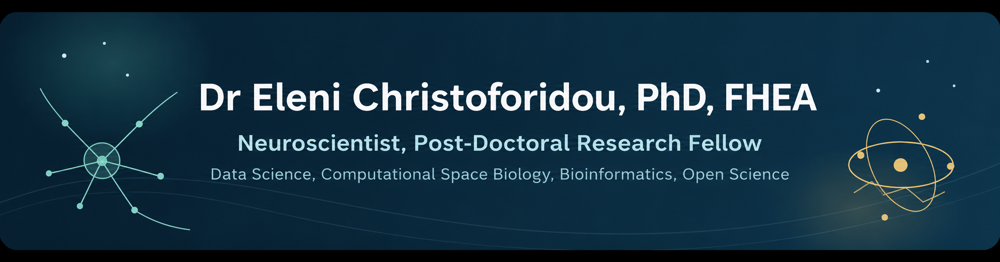

<!-- GitHub profile README for github.com/eleni-chr -->

  

   
   

  <strong>Dr Eleni Christoforidou, PhD, FHEA</strong> 
  Neuroscientist · Post-Doctoral Research Fellow

   
   

  
  
  
  

---

## About

I am a neuroscientist investigating neurodegeneration, neuroinflammation, and neuromuscular diseases through molecular biology, cellular biology, transcriptomics, bioinformatics, and quantitative imaging. My work focuses on building and applying computational workflows that help make complex biological datasets interpretable and reproducible.

Alongside my core research in neurodegeneration, I am also developing **computational space biology** as a complementary area of interest, using NASA and JAXA spaceflight datasets to study how biological systems respond to microgravity.

I am committed to **open science, transparent methods and reusable research software**.

## Research focus

- **Neurodegeneration and neuromuscular biology** — ALS/MND, skeletal muscle, motor neurons and neuromuscular junctions
- **RNA and molecular data analysis** — RNA-seq, microRNA biology, alternative polyadenylation and transcriptomic profiling
- **Computational space biology** — spaceflight biology, unloading/reloading models and cross-dataset omics analysis
- **Quantitative imaging and image analysis** — confocal microscopy, fluorescence localisation, morphometry and spatial analysis
- **Data science for biology** — reproducible analysis pipelines, statistical modelling, visualisation and open computational workflows

## Selected repositories

| Repository | Focus |
| :--- | :--- |
| [**NMJ-MN-image-analysis-toolkit**](https://github.com/eleni-chr/NMJ-MN-image-analysis-toolkit) | Morphometric and localisation analysis of neuromuscular-junction and motor-neuron microscopy images |
| [**interneuron-microscopy-analysis**](https://github.com/eleni-chr/interneuron-microscopy-analysis) | ImageJ/Fiji and MATLAB pipeline for interneuron quantification and spatial-distribution analysis |
| [**long-read-RNA-seq-plotting-suite**](https://github.com/eleni-chr/long-read-RNA-seq-plotting-suite) | Utilities for inspecting, extracting and visualising long-read RNA-seq data |
| [**qPCR-replicate-analysis**](https://github.com/eleni-chr/qPCR-replicate-analysis) | Statistical analysis of qPCR technical replicates and reproducibility |
| [**cell-morphometry**](https://github.com/eleni-chr/cell-morphometry) | Quantitative extraction of cell-shape and morphology descriptors from microscopy images |
| [**colocalisation**](https://github.com/eleni-chr/colocalisation) | Pixel-based fluorescence colocalisation analysis for confocal microscopy images |

## Forthcoming repositories

These analysis repositories are currently being prepared for public release.

| Project | Status |
| :--- | :--- |
| **ALS muscle × spaceflight and mechanical unloading** | Comparative transcriptomics, pathway enrichment and reversible gene-programme analysis · *Repository coming soon* |
| **Alternative polyadenylation in TDP-43 muscle** | APA, mRNA expression and regulatory analysis across disease stages · *Repository coming soon* |
| **Plasma microRNA biomarkers in ALS** | Longitudinal biomarker analysis and cross-cohort comparison · *Repository coming soon* |

## Methods and tools

**Languages and platforms**

**Methods**

`RNA-seq` · `Differential expression` · `DESeq2` · `microRNA analysis` · `Alternative polyadenylation` · `Pathway enrichment` · `Confocal microscopy` · `Image analysis` · `Statistical analysis` · `Data visualisation` · `Open science`

## Open research

- **Publications and profile:** [Website](https://www.elenichr.com/) · [Publications](https://www.elenichr.com/publications) · [ORCID](https://orcid.org/0000-0002-9352-4908)
- **Open datasets:** [PRJEB96186](https://www.ebi.ac.uk/ena/browser/view/PRJEB96186) · [PRJEB61796](https://www.ebi.ac.uk/ena/browser/view/PRJEB61796)
- **Research background:** [Research experience](https://www.elenichr.com/research-experience) · [Coding experience](https://www.elenichr.com/coding-experience)

## Connect

If your interests overlap with **ALS/MND, computational biology, space biology, imaging, transcriptomics or data science**, feel free to connect via [LinkedIn](https://www.linkedin.com/in/elenichristoforidou/) or through [my website](https://www.elenichr.com/).

---

  Open scientific code · Reproducible methods · Quantitative biology

